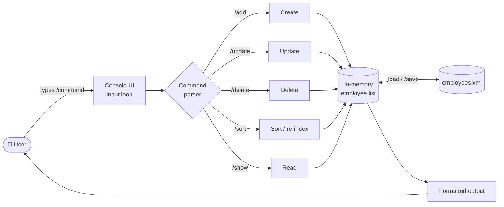

<div align="center">

<!-- Animated header banner (local file) -->


<!-- Animated typing line -->
<a href="https://github.com/MIhajloS07/EmployeeManagerXML">
  
</a>

<br/>

[](https://learn.microsoft.com/dotnet/csharp/)
[](https://dotnet.microsoft.com/)
[](https://www.w3.org/XML/)
[](https://visualstudio.microsoft.com/)
[](LICENSE)


</div>

---

## 📑 Table of Contents

- [Overview](#-overview)
- [Preview](#-preview)
- [Features](#-features)
- [Architecture](#-architecture)
- [Data Model](#-data-model)
- [Tech Stack](#-tech-stack)
- [Getting Started](#-getting-started)
- [Usage](#-usage)
- [Example Session](#-example-session)
- [Project Structure](#-project-structure)
- [Design Decisions](#-design-decisions)
- [Roadmap](#-roadmap)
- [Contributing](#-contributing)
- [License](#-license)

---

## 🎯 Overview

**Employee Manager XML** is a terminal-based application for managing employee records. It implements the full **CRUD** lifecycle (Create, Read, Update, Delete) on top of a plain **XML file**, which acts as a lightweight, human-readable database.

The project is a practical demonstration of:

- **XML parsing and manipulation** in C# (loading, querying, mutating and persisting a document)
- **Command-driven console interfaces** with a slash-command syntax
- **Stateful ID management**, including auto-generation and re-sequencing
- Persistence without any external database engine

> 💡 **Why XML?** It requires no server, no setup and no extra packages. The data file can be opened, diffed and version-controlled with any text editor, which makes it ideal for learning, prototyping and small tools.

---

## 🖼 Preview

<div align="center">


<br/><br/>

<br/><br/>

&nbsp;&nbsp;


<sub><i>The application running in a console window.</i></sub>

</div>

---

## ✨ Features

| | Feature | Details |
|---|---|---|
| ➕ | **Create** | Add employees; unique IDs are generated automatically |
| 📋 | **Read** | List every employee in a clean, aligned console view |
| ✏️ | **Update** | Modify full name, age or role independently |
| 🗑 | **Delete** | Remove an employee by ID |
| 🔢 | **Sort / re-index** | Sort by ID and reassign sequential IDs |
| 💾 | **Explicit save** | Persist the in-memory state to XML on demand |
| 🧭 | **Built-in help** | `/help` lists every available command |
| 🧹 | **Console utilities** | `/clear` and `/exit` for a smooth session |

---

## 🏗 Architecture



**Flow of a session**

1. On startup the XML file is **loaded** into memory.
2. The app enters a **read–parse–execute** loop and waits for a slash command.
3. Each command mutates or queries the in-memory collection.
4. `/save` **serializes** the current state back to the XML file.

---

## 🗂 Data Model

Each employee is stored as an XML element with the following attributes:

| Field | Type | Description |
|-------|------|-------------|
| `Id` | `int` | Unique identifier, auto-generated |
| `FullName` | `string` | Employee's first and last name |
| `Age` | `int` | Employee's age |
| `Role` | `string` | Job title / position |

Illustrative shape of the stored document *(the exact element names are defined in the source code)*:

```xml
<?xml version="1.0" encoding="utf-8"?>
<Employees>
  <Employee>
    <Id>1</Id>
    <FullName>John Doe</FullName>
    <Age>25</Age>
    <Role>Developer</Role>
  </Employee>
</Employees>
```

---

## 🧰 Tech Stack

<div align="center">

| Layer | Technology |
|-------|-----------|
| Language | **C#** |
| Runtime | **.NET** |
| Persistence | **XML** (`System.Xml` / LINQ to XML) |
| IDE | **Visual Studio** |
| Version control | **Git & GitHub** |

</div>

---

## 🚀 Getting Started

### Prerequisites

- [.NET SDK](https://dotnet.microsoft.com/download) (match the target framework in the project's `.csproj`)
- *Optional:* [Visual Studio](https://visualstudio.microsoft.com/) 2022 or newer

Verify your installation:

```bash
dotnet --version
```

### Installation

**1. Clone the repository**

```bash
git clone https://github.com/MIhajloS07/EmployeeManagerXML.git
cd EmployeeManagerXML
```

**2. Build**

```bash
dotnet build "xml projekat.sln"
```

**3. Run**

```bash
dotnet run --project "xml projekat"
```

<details>
<summary><b>🪟 Prefer Visual Studio?</b></summary>

1. Open `xml projekat.sln`
2. Set the console project as the startup project
3. Press <kbd>F5</kbd> (debug) or <kbd>Ctrl</kbd> + <kbd>F5</kbd> (run without debugging)

</details>

---

## 🎮 Usage

Once running, everything is controlled through **slash commands**.

### CRUD Operations

| Operation | Command | Description |
|-----------|---------|-------------|
| ➕ Create | `/add` | Add a new employee |
| 📋 Read | `/show` | Display all employees |
| ✏️ Update | `/update -fullname` | Update an employee's full name |
| ✏️ Update | `/update -age` | Update an employee's age |
| ✏️ Update | `/update -role` | Update an employee's role |
| 🗑 Delete | `/delete` | Remove an employee by ID |

### Utility Commands

| Command | Description |
|---------|-------------|
| `/save` | Save all employee data to the XML file |
| `/sort` | Sort employees and reassign IDs |
| `/help` | Display the help menu |
| `/clear` | Clear the console |
| `/exit` | Exit the application |

> ⚠️ **Tip:** run `/save` before `/exit` so your changes are written to disk.

---

## 🧪 Example Session

**Adding an employee**

```text
> /add
Enter full name: John Doe
Enter age: 25
Enter role: Developer
Employee John Doe added.
```

**Listing employees**

```text
> /show
```

**Updating a role**

```text
> /update -role
```

**Persisting changes**

```text
> /save
> /exit
```

---

## 📁 Project Structure

```text
EmployeeManagerXML/
├── xml projekat/          # C# console project (source code)
├── xml projekat.sln       # Visual Studio solution
├── .gitattributes
├── .gitignore
├── LICENSE                # MIT
└── README.md
```

---

## 🧠 Design Decisions

- **XML over a database engine**: removes all setup friction and keeps data transparent and diffable.
- **Slash-command interface**: a consistent, discoverable syntax that is easy to extend with new commands.
- **In-memory working set + explicit `/save`**: fast operations and a clear persistence boundary.
- **Re-sequencing IDs via `/sort`**: keeps identifiers contiguous after deletions.

---

## 🗺 Roadmap

- [x] Full CRUD over XML
- [x] Auto-generated IDs
- [x] Sort and re-index
- [ ] Input validation (age range, empty fields)
- [ ] Search and filter (by name, role, age)
- [ ] Auto-save on exit
- [ ] Export to CSV / JSON
- [ ] Unit tests (xUnit)
- [ ] CI pipeline with GitHub Actions

---

## 🤝 Contributing

Contributions, issues and feature requests are welcome.

1. **Fork** the project
2. Create a feature branch: `git checkout -b feature/amazing-feature`
3. Commit your changes: `git commit -m "Add amazing feature"`
4. Push the branch: `git push origin feature/amazing-feature`
5. Open a **Pull Request**

---

## 📄 License

Distributed under the **MIT License**. See [`LICENSE`](LICENSE) for details.

---

<div align="center">

**Made with ❤️ and C# by [MIhajloS07](https://github.com/MIhajloS07)**

⭐ If you found this project useful, consider giving it a star!


</div>
